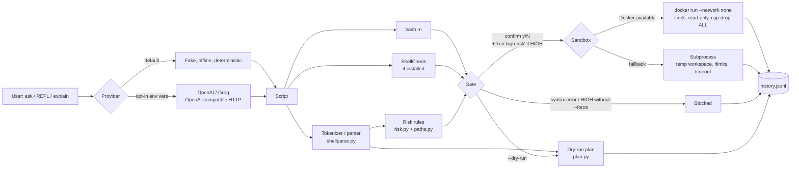

# TermaAI

[](https://github.com/tatitoxt/termaai/actions/workflows/ci.yml)


A terminal AI assistant that turns natural-language requests into Bash scripts and runs
them **only after** a safety pipeline: syntax check, ShellCheck, a rule-based risk analyzer,
an optional dry-run plan, explicit confirmation, a sandbox, and an append-only audit log.

## The problem

"Ask an LLM for a shell command and paste it" is fast, and occasionally catastrophic.
A generated script can `rm -rf` the wrong directory, pipe a remote installer into `sh`,
write to `/etc` or a block device, or upload `~/.ssh` somewhere. Reading every line
carefully defeats the point of asking. TermaAI keeps the convenience but puts a
deterministic, inspectable gate between the model and your machine.

## What it does today

| Feature | Where | Exercised by |
| --- | --- | --- |
| `termaai ask "..."`, interactive REPL (`termaai` / `termaai repl`), `termaai explain script.sh`, `termaai history` | `src/termaai/cli.py` | `tests/integration/test_cli.py`, `tests/e2e/` |
| Deterministic offline **fake provider** (default, no API key) | `providers/fake.py` | all tests and the demo |
| **OpenAI** and **Groq** providers, opt-in via env vars (stdlib HTTP client, no SDK) | `providers/openai_compat.py` | `test_cli.py` against a local HTTP stub (no real API calls) |
| `bash -n` syntax check (scripts that do not parse are blocked) | `safety/checks.py` | unit, integration, E2E |
| ShellCheck findings when `shellcheck` is installed | `safety/checks.py` | `tests/unit/test_checks.py` |
| Rule-based **risk analyzer** with LOW / MEDIUM / HIGH and a per-finding explanation and line number | `safety/risk.py`, `safety/shellparse.py`, `safety/paths.py` | labelled corpus of 69 dangerous + 23 safe scripts in `tests/corpus/` |
| **Dry-run**: parsed command plan, effects (read/write/delete/network/...) and touched paths, nothing executed | `plan.py` | unit, integration, E2E |
| **Docker sandbox**: `--network none`, workspace bind mount, memory / CPU / PID / file-size limits, timeout, read-only rootfs, all capabilities dropped, non-root user | `executor.py` | `tests/integration/test_executor.py` (checks cgroup limits, no network, read-only rootfs, timeout) |
| **Subprocess fallback** in a temporary workspace: scrubbed env, rlimits, timeout, process-group kill | `executor.py` | integration + E2E |
| Confirmation always required; HIGH risk blocked unless `--force` **and** typing `run high-risk` | `assistant.py` | E2E confirm / deny / force flows |
| JSONL **audit history** (prompt, script + SHA-256, risk level and findings, decision, sandbox, exit code), file mode `0600` | `audit.py` | unit, integration, E2E |

Finding IDs the analyzer can report (each has a corpus example in `tests/corpus/dangerous/`):

| Area | Finding IDs | Examples |
| --- | --- | --- |
| Deletion | `destructive_rm` (HIGH), `recursive_delete` (MEDIUM, inside the workspace) | `rm -rf /`, `rm -rf "$EMPTY"/`, `find / -delete` |
| Writes | `write_outside_workspace` | `> /etc/hosts`, `cp x /usr/bin`, `tee ~/.bashrc`, `../` |
| Remote code | `remote_code_execution`, `obfuscated_execution`, `dynamic_eval` | `curl ... \| sh`, `bash <(curl ...)`, `base64 -d \| sh`, `eval` |
| Privilege | `privilege_escalation` | `sudo`, `su`, `doas`, setuid bits |
| Resources | `fork_bomb` | `:(){ :\|:& };:` |
| Permissions | `insecure_permissions` | `chmod 777`, `chmod 666` |
| Devices | `device_write` | `dd of=/dev/sda`, `mkfs`, `wipefs`, `shred /dev/...` |
| Network | `network_exfiltration` (HIGH), `network_access` (MEDIUM) | `curl -T`, `curl -d @file`, `/dev/tcp`, `\| nc`, `scp` out |
| Secrets | `credential_access` | `~/.ssh`, `~/.aws`, `/etc/shadow` |
| System | `system_state`, `persistence`, `history_tampering`, `package_install` | `shutdown`, `systemctl stop`, `crontab`, `history -c`, `apt-get install` |

## Quickstart

Requirements: Linux, Python 3.10+, Bash. Optional: Docker (for the real sandbox) and
ShellCheck.

```bash
git clone https://github.com/tatitoxt/termaai.git
cd termaai
python3 -m venv .venv && . .venv/bin/activate
pip install -r requirements-dev.txt -e .

# Optional: the Docker sandbox image (any image with bash works, see TERMAAI_SANDBOX_IMAGE)
docker pull bash:5.2
```

### Demo (fake provider, no API key needed)

The fake provider maps a few phrases to fixed scripts so the demo is reproducible.
Everything runs in a fresh temporary workspace unless you pass `--workspace`.

```bash
# LOW risk: shows the script, checks and risk, then asks before running it
termaai ask "create a note"

# Dry run: command plan + paths that would be touched, never executes
termaai ask "backup the workspace" --dry-run

# MEDIUM risk: recursive delete inside the workspace, still asks first
termaai ask "remove the build cache" --workspace /tmp/termaai-demo

# HIGH risk: `curl | sh` is blocked outright (exit code 4)
termaai ask "install the tool"

# ...unless you pass --force AND type the phrase "run high-risk" at the second prompt
termaai ask "install the tool" --force

# Timeout enforcement (exit code 124)
termaai ask "loop forever" --timeout 2

# Explain an existing script without running it
termaai explain tests/corpus/dangerous/curl_pipe_sh.sh

# Audit trail
termaai history
termaai history --json

# Interactive REPL (:dry toggles dry-run, :history, :help, :quit)
termaai
```

Other fake phrases: `list files`, `count lines`, `disk usage`, `make it world-writable`,
`please fail`, `something broken` (fails `bash -n`). Unknown requests produce a harmless
`printf` that echoes the request.

Exit codes: script's own exit code when it ran, `3` denied, `4` blocked, `5` provider or
sandbox error, `124` timeout.

### Real providers (opt-in)

```bash
export TERMAAI_PROVIDER=openai OPENAI_API_KEY=...   # default model gpt-4o-mini
export TERMAAI_PROVIDER=groq   GROQ_API_KEY=...     # default model llama-3.1-8b-instant
# optional: TERMAAI_MODEL, TERMAAI_OPENAI_BASE_URL, TERMAAI_GROQ_BASE_URL
termaai ask "find the five largest files here"
```

Generated scripts go through exactly the same pipeline as fake ones. The real providers
were only tested against a local HTTP stub, not against the live APIs.

### Configuration

| Variable | Purpose |
| --- | --- |
| `TERMAAI_PROVIDER` | `fake` (default), `openai`, `groq` |
| `TERMAAI_HOME` | Where `history.jsonl` lives (default `$XDG_DATA_HOME/termaai` or `~/.local/share/termaai`) |
| `TERMAAI_SANDBOX_IMAGE` | Docker image for the sandbox (default `bash:5.2`) |
| `TERMAAI_SHELLCHECK` | Path to a `shellcheck` binary, or `off` to disable |

## Architecture



The analyzer does not execute anything: it tokenizes the script (quotes, pipelines,
redirections, `$(...)` / backticks, `bash -c '...'`, heredocs, `sudo`/`env`/`xargs`
wrappers), resolves each path argument relative to the workspace, and applies small rule
functions to each simple command and pipeline.

## Tests

```bash
ruff check . && ruff format --check . && mypy        # lint + strict type check
pytest tests/unit                                     # parser, paths, analyzer + corpus, planner, providers, checks, audit
pytest tests/integration                              # executors (subprocess + Docker), CLI flows, OpenAI-compatible client vs local stub
pytest tests/e2e -v                                   # pexpect drives the installed `termaai` binary in a PTY
pytest                                                # everything
```

Docker-dependent tests are marked `docker` and skip when no daemon or image is available;
set `TERMAAI_REQUIRE_DOCKER=1` (as CI does) to make that a failure instead. Each test
gets its own `TERMAAI_HOME`, so your real history is never touched.

The E2E suite spawns the real console script, waits for the `[y/N]` prompt and answers
it: confirm, deny, empty answer (defaults to no), HIGH-risk block, `--force` with a wrong
and with the correct second confirmation, timeout, dry-run, a REPL session, `explain`
and `history`. Several of these run in both the Docker and the subprocess sandbox.

Measured in this repository at the time of writing (`pytest -q`): **214 tests**
(161 unit, 40 integration, 13 E2E) passing locally with Docker
and ShellCheck available; CI runs the same suites on Python 3.10 and 3.12.

### Dependency audit

`pip-audit .` (runtime dependencies) reports no known vulnerabilities. `pip-audit -r
requirements-dev.txt` reports two MODERATE advisories (GHSA-8mx5-7m5m-r77g,
GHSA-69hj-f68j-2879) in `filelock`, a transitive dependency of `pip-audit` itself; the
only fixed `filelock` release was about a month old when this was written, so CI ignores
exactly those two IDs and fails on anything else.

## Limitations (honest)

- **The analyzer is heuristic.** It is a best-effort static parser, not a Bash
  interpreter. Obfuscation (variables holding command names, `eval` of computed strings,
  aliases, functions defined elsewhere) can hide intent; some such constructs are flagged
  as MEDIUM/HIGH, but a determined adversary can evade rules. Treat it as a seat belt,
  not a security boundary.
- **The subprocess fallback is not isolation.** It scrubs the environment, sets rlimits
  and a timeout and runs in a temporary directory, but the script still runs as your user
  with your network and filesystem permissions. The CLI says so when it falls back. Use
  Docker for anything you do not fully trust.
- **The Docker sandbox depends on Docker's own isolation** and on the image you choose.
  The default `bash:5.2` image is minimal: tools like `curl`, `jq` or `python` are not in
  it, so a forced `curl | sh` simply fails with exit code 127 there.
- Paths are classified for the workspace given at analysis time; scripts that `cd`
  elsewhere and then use relative paths are only partially tracked.
- The fake provider only knows a handful of phrases. The OpenAI/Groq clients were tested
  against a local HTTP stub, not live APIs, and have no streaming or retries.
- Developed and tested on Linux only (rlimits, process groups, Docker). macOS and
  Windows are untested.
- No authentication, multi-user setup or log rotation for the audit file.

## Roadmap

- Parse with a real Bash grammar (e.g. tree-sitter-bash) instead of the hand-written
  tokenizer, and track `cd` for relative paths.
- Let the user edit a generated script before running it, and feed analyzer findings back
  to the model to request a safer version.
- Configurable policy file (allow/deny rules, per-workspace risk thresholds).
- Optional gVisor / rootless Podman backends and a curated sandbox image with common
  tools but still no network.
- Record and replay of provider responses for regression tests on real model output.

## License

[MIT](LICENSE) © Fausto Pastura
